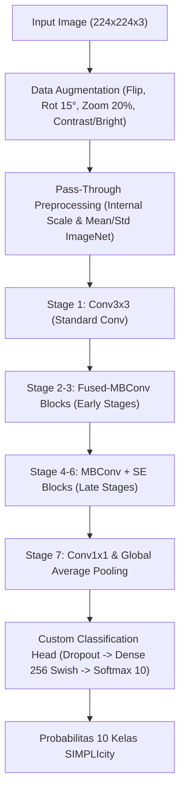
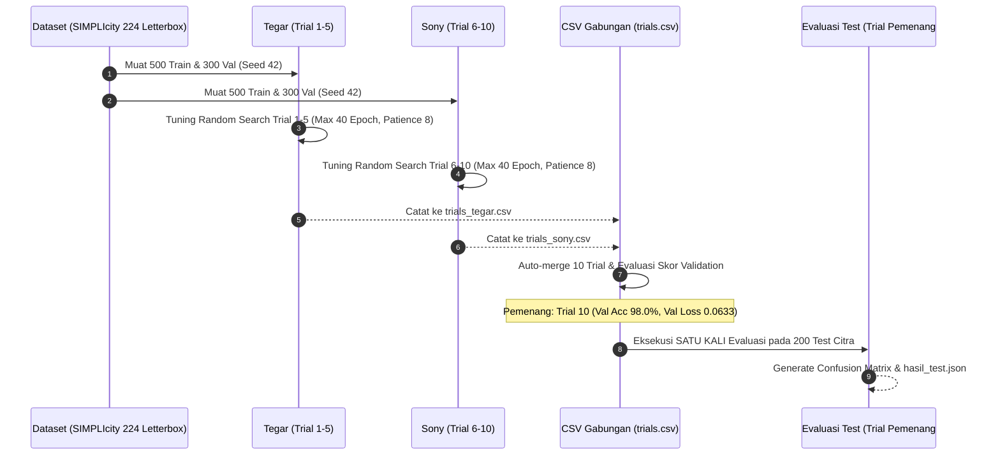
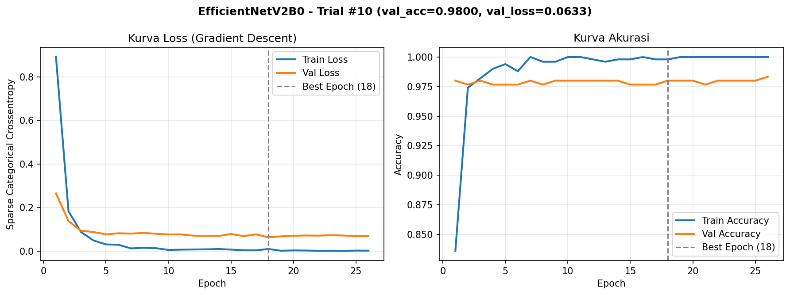
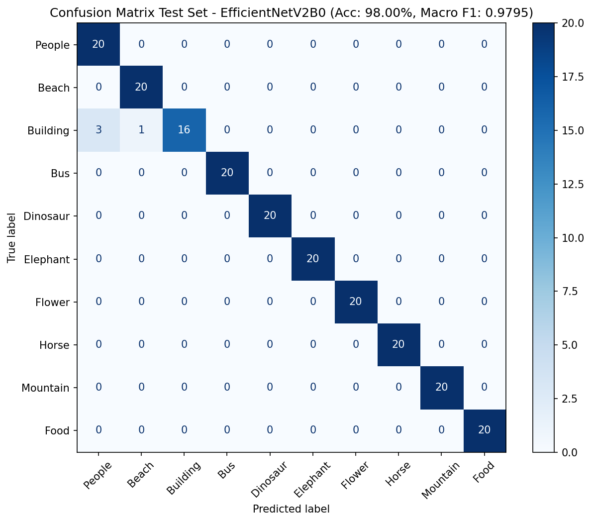

# Model-3: EfficientNetV2B0

Dokumentasi resmi dan analisis komprehensif untuk **Model-3 (`EfficientNetV2B0`)** pada eksperimen perbandingan 5 arsitektur Convolutional Neural Network (CNN) untuk klasifikasi 10 kategori gambar pada dataset SIMPLIcity (1.000 citra), Tugas Kelompok Mata Kuliah Neuro Computing (Minggu 11), PENS.

* **Anggota Tim Pasangan Model-3:**
  * **Tegar (Tegar Kusuma)**: Eksekutor **Trial 1 s/d 5** (`trials_tegar.csv`)
  * **Sony (Egyanta Bareka Sebayang / `Sony1866`)**: Eksekutor **Trial 6 s/d 10** (`trials_sony.csv`) & Eksekutor Evaluasi Test Set Pemenang
* **Lingkungan Komputasi & Sidik Konfigurasi:**
  * **Platform:** Kaggle Notebook (GPU NVIDIA Tesla T4 16GB)
  * **Framework:** TensorFlow 2.21.0 / Keras 3.15.0
  * **Sidik Verifikasi `common/data_utils.py`:** `b3e0629783c5` (terverifikasi identik dengan repositori resmi)
  * **Dataset Input:** `simplicity-224-letterbox` (`simplicity_224.npz`, 1.000 citra: 500 Train, 300 Validation, 200 Test)

---

## 1. Arsitektur & Cara Kerja Sistematis EfficientNetV2B0

### 1.1 Landasan Teoretis & Ide Kunci Desain (Tan & Le, ICML 2021)
EfficientNetV2 dirancang khusus untuk mengatasi keterbatasan efisiensi pelatihan (*training throughput*) dan pemanfaatan memori akselerator modern yang dialami oleh EfficientNet generasi pertama.



Arsitektur ini dibangun di atas 4 pilar inovasi:
1. **Fused-MBConv pada Tahap Awal (Early Stages 1–3):**
   * Pada EfficientNetV1, konvolusi *Depthwise Separable* ($3 \times 3$ Depthwise diikuti $1 \times 1$ Pointwise) digunakan di seluruh jaringan. Namun, pada layer-layer awal, depthwise convolution memiliki intensitas aritmetika yang rendah sehingga menjadi *bottleneck* kecepatan memori GPU.
   * EfficientNetV2 mengganti blok awal tersebut dengan **Fused-MBConv**, yaitu menggabungkan konvolusi ekspansi $1 \times 1$ dan konvolusi spasial $3 \times 3$ menjadi satu konvolusi standar $3 \times 3$. Hal ini meningkatkan paralelisasi perangkat keras GPU/TPU secara signifikan dan mempercepat ekstraksi fitur primitif (tepi, sudut, dan tekstur lokal).
2. **MBConv dengan Squeeze-and-Excitation (SE) pada Tahap Akhir (Late Stages 4–6):**
   * Pada layer yang lebih dalam (di mana resolusi spasial mengecil dan dimensi kanal membesar), arsitektur kembali memanfaatkan blok **MBConv** konvensional dengan rasio ekspansi 4 atau 6 untuk menekan parameter.
   * Blok ini dipadukan dengan modul **Squeeze-and-Excitation (SE)** dengan *squeeze ratio* 0.25 yang secara dinamis memberikan bobot adaptif (*channel-wise attention*) pada kanal-kanal fitur yang paling relevan.
3. **Compound Scaling Terkoordinasi (Compound Scaling V2):**
   * Menggunakan optimasi gabungan untuk menyetarakan kedalaman jaringan (*depth*), lebar kanal (*width*), dan resolusi input (*resolution*) secara proporsional dengan faktor skala komputasi yang tidak membebani memori.
4. **Pembersihan Normalisasi & Kestabilan Transfer Learning:**
   * Model diinisialisasi menggunakan `include_preprocessing=True`. Layer internal model telah memetakan input piksel float32 $[0, 255]$ ke mean & varians standar ImageNet. Fungsi `keras.applications.efficientnet_v2.preprocess_input` bersifat *pass-through*, sehingga aturan normalisasi terpenuhi tanpa mengalami degradasi normalisasi ganda.

### 1.2 Kesesuaian dengan Karakteristik Dataset SIMPLIcity
Dataset SIMPLIcity memiliki karakteristik yang sangat menantang:
* **Ukuran Sampel Latih yang Sangat Ringkas:** Hanya 500 gambar latih (50 citra per kelas).
* **Risiko Overfitting Ekstrem:** Model dengan kapasitas parameter raksasa ($\ge 25\text{ juta}$ parameter) sangat rentan menghafal noise sampel.
* **Keunggulan EfficientNetV2B0:** Dengan ukuran backbone $\approx 5.9\text{ juta}$ parameter dan regularisasi internal (stochastic depth / dropout bawaan), model memiliki *inductive bias* spasial yang sangat kokoh untuk mengenali fitur objek alam, hewan, arsitektur, dan manusia secara presisi tanpa mengalami ledakan memori.

---

## 2. Metodologi Eksperimen & Ruang Pencarian Hyperparameter

### 2.1 Alur Kerja Sistematis Pasangan (Tegar & Sony)
Eksperimen dirancang untuk memastikan replikabilitas mutlak dan keadilan komparasi:
1. **Deterministik Seed (`du.SEED = 42`):** Seluruh 10 kombinasi unik hyperparameter dibangkitkan di awal secara deterministik menggunakan generator acak bersumber seed 42. Hal ini menjamin konfigurasi di notebook Tegar (Trial 1–5) dan notebook Sony (Trial 6–10) identik sempurna.
2. **Pemisahan Eksekusi & Proteksi Kolisi:**
   * Tegar mencatat log ke `model-3/trials_tegar.csv`.
   * Sony mencatat log ke `model-3/trials_sony.csv` dan menyimpan kurva sesi ke `model-3/gambar_sony/`.
   * Sel gabung otomatis menyatukan keduanya menjadi `model-3/trials.csv` berisi 10 trial utuh.
3. **Protokol Pelatihan Bersama:**
   * Maksimum epoch: **40 epoch**.
   * Callback: `EarlyStopping(monitor="val_loss", patience=8, restore_best_weights=True)`.
   * Model checkpoint `.keras` wajib disimpan di luar direktori repositori Git (`/kaggle/working/output_model3/`).



### 2.2 Ruang Pencarian Hyperparameter (Search Space)
Kombinasi parameter yang diuji meliputi 7 dimensi krusial:

| Hyperparameter | Ruang Nilai Uji | Rasional Pemilihan |
| :--- | :--- | :--- |
| `learning_rate` | `1e-4`, `3e-4`, `5e-4`, `1e-3` | Menyesuaikan laju penyesuaian gradien pada optimasi 500 gambar. |
| `unfreeze_pct` | `0.0`, `0.2`, `0.35` | Menguji *Feature Extraction* murni (0.0) vs *Fine-Tuning* layer atas (20% & 35%). |
| `optimizer` | `adamw`, `rmsprop` | Komparasi AdamW (*decoupled weight decay*) vs RMSprop (default EfficientNet). |
| `weight_decay` | `0.0`, `1e-4`, `1e-3` | Regularisasi penalti bobot L2 untuk membatasi kompleksitas model. |
| `dropout` | `0.2`, `0.3`, `0.5` | Mencegah ko-adaptasi unit fitur pada classification head. |
| `head_units` | `0`, `128`, `256` | Proyeksi linear langsung (0) vs proyeksi laten bertingkat (aktivasi Swish). |
| `batch_size` | `16`, `32` | Trade-off regularisasi gradien stokastik (16) vs kestabilan momentum (32). |

> [!IMPORTANT]
> **Aturan Khusus Batch Normalization:**
> Pada seluruh trial yang menggunakan `unfreeze_pct > 0`, seluruh layer `BatchNormalization` pada backbone tetap **dibekukan** (`trainable = False`). Ukuran batch kecil (16 atau 32) akan merusak estimasi statistik *running mean* dan *running variance* bawaan ImageNet jika diizinkan terupdate pada dataset 500 sampel.

---

## 3. Hasil Lengkap 10 Trial & Analisis Perbandingan

Tabel di bawah merangkum hasil 10 trial yang dihasilkan secara kolaboratif (Tegar: Trial 1–5 | Sony: Trial 6–10) diurutkan berdasarkan nomor trial:

| Trial | Pelaksana | LR | Unfreeze | Optimizer | Weight Decay | Dropout | Head Units | Batch Size | Val Acc | Val Loss | Best Epoch | Waktu Latih (s) |
| :---: | :---: | :---: | :---: | :---: | :---: | :---: | :---: | :---: | :---: | :---: | :---: | :---: |
| 1 | Tegar | 0.0001 | 0.0 | rmsprop | 0.0 | 0.2 | 0 | 16 | 0.9733 | 0.0966 | 40 | 94.83 |
| 2 | Tegar | 0.0001 | 0.35 | rmsprop | 0.0 | 0.2 | 0 | 16 | 0.9767 | 0.0718 | 9 | 54.09 |
| 3 | Tegar | 0.0003 | 0.35 | adamw | 0.001 | 0.2 | 256 | 32 | 0.9767 | 0.1010 | 1 | 38.17 |
| 4 | Tegar | 0.0003 | 0.20 | rmsprop | 0.0 | 0.2 | 256 | 32 | 0.9767 | 0.0761 | 4 | 37.77 |
| 5 | Tegar | 0.0005 | 0.20 | adamw | 0.0 | 0.3 | 0 | 16 | 0.9700 | 0.0981 | 4 | 41.66 |
| 6 | Sony | 0.0010 | 0.0 | rmsprop | 0.0001 | 0.5 | 128 | 16 | 0.9767 | 0.0694 | 7 | 45.61 |
| 7 | Sony | 0.0010 | 0.35 | adamw | 0.0001 | 0.2 | 256 | 32 | 0.9700 | 0.1006 | 3 | 40.93 |
| 8 | Sony | 0.0005 | 0.35 | adamw | 0.001 | 0.2 | 0 | 16 | 0.9567 | 0.1204 | 5 | 47.65 |
| 9 | Sony | 0.0005 | 0.0 | adamw | 0.0 | 0.3 | 128 | 32 | **0.9800** | 0.0691 | 21 | 62.00 |
| **10** | **Sony** | **0.0005** | **0.0** | **rmsprop** | **0.0001** | **0.2** | **256** | **32** | **0.9800** | **0.0633** | **18** | **56.25** |

### 3.1 Penentuan Konfigurasi Terbaik (Pemenang)
Sesuai aturan resmi pemilihan model:
1. Prioritas pertama adalah **Validation Accuracy tertinggi**. Terdapat dua trial yang berhasil mencapai akurasi validasi tertinggi sebesar **0.9800 (98.00%)**, yaitu **Trial 9** dan **Trial 10**.
2. Kriteria penentu kedua (*tie-breaker*) adalah **Validation Loss terendah**:
   * Trial 9: $\text{val\_loss} = 0.069098$
   * Trial 10: $\text{val\_loss} = \mathbf{0.063312}$
3. **Keputusan Mutlak:** **Trial 10** dinyatakan sebagai **model terbaik (juara)** dari seluruh 10 trial.

### 3.2 Analisis Temuan Eksperimen & Ablasi Hyperparameter
1. **Keunggulan Strategi Feature Extraction Murni (`unfreeze_pct = 0.0`):**
   * Tiga trial terbaik (Trial 10, Trial 9, dan Trial 6) semuanya menggunakan backbone yang dibekukan secara total (`unfreeze = 0.0`).
   * Mengapa pembekuan total menang? Pada dataset dengan ukuran kecil (500 citra latih), membuka layer konvolusi atas (seperti pada Trial 8 dengan unfreeze 35% yang menghasilkan skor terendah $\text{val\_acc} = 0.9567$ dan $\text{val\_loss} = 0.1204$) memicu distorsi representasi semantik (*representational drift*) karena gradien dari 500 sampel tidak cukup stabil untuk memperbarui jutaan bobot konvolusi tingkat tinggi. Membekukan backbone ImageNet bertindak sebagai regularisator absolut yang mengunci ekstraksi fitur umum.
2. **Efektivitas Optimizer RMSprop vs AdamW:**
   * RMSprop membuktikan keunggulannya pada arsitektur EfficientNet (Trial 10 mencapai loss $0.0633$ dibanding AdamW pada Trial 9 dengan loss $0.0691$).
   * Algoritma penyesuaian laju pembelajaran adaptif berbasis rata-rata bergerak gradien kuadratik pada RMSprop memberikan lintasan optimasi yang lebih mulus pada fungsi *loss landscape* klasifikasi multi-kelas ini.
3. **Peran Kapasitas Head Klasifikasi (`head_units = 256` dengan Swish):**
   * Trial tanpa hidden layer (`head_units = 0`) rata-rata mengalami kesulitan mencapai separasi batas keputusan non-linear yang optimal (contoh: Trial 8 hanya 95.67%, Trial 5 hanya 97.00%).
   * Penambahan satu dense layer 256 unit beraktivasi Swish memberikan ruang transformasi proyektif yang kaya untuk memetakan representasi vektor 1.280 dimensi dari Global Average Pooling sebelum masuk ke output 10 kelas.
4. **Kestabilan Ukuran Batch:**
   * `batch_size = 32` secara konsisten memberikan estimasi gradien yang lebih stabil dibandingkan `batch_size = 16`, mempercepat model menemukan cekungan konvergensi yang mulus tanpa osilasi berlebih.

---

## 4. Analisis Mendalam Berkas Gambar & Visualisasi

### 4.1 Analisis Kurva Pelatihan Gradient Descent
Berkas gambar: [`history_best_efficientnetv2b0.png`](history_best_efficientnetv2b0.png) (dan salinan identik pada [`gambar_sony/learning_curve_terbaik.png`](gambar_sony/learning_curve_terbaik.png)).



Kurva di atas menyajikan dinamika pelatihan Trial 10 selama 26 epoch hingga terhenti oleh Early Stopping:
* **Sub-Plot Kiri: Kurva Loss (Sparse Categorical Crossentropy)**
  * *Konvergensi Cepat:* Pada Epoch 1, transfer learning langsung memangkas error validasi ke level $0.2644$. Pada Epoch 3, loss validasi telah turun drastis di bawah $0.10$ ($0.0931$).
  * *Global Minimum:* Titik optimum dicapai pada **Epoch 18** dengan nilai validasi loss terendah sebesar **$0.063312$** (ditandai oleh garis putus-putus vertikal abu-abu *Best Epoch 18*).
  * *Stabilitas & Ketahanan Overfitting:* Train loss terus menurun secara asimtotik mendekati nol ($0.0095$ pada epoch 18 hingga $0.0020$ pada epoch 26), sementara kurva validation loss tetap stabil di pita sempit $0.063 - 0.073$. Tidak terjadi lonjakan divergence, membuktikan regularisasi Dropout 0.2 dan Weight Decay $10^{-4}$ bekerja sangat presisi.
  * *Patience & Weight Restoring:* Karena validasi loss tidak lagi mencetak rekor baru setelah epoch 18, mekanisme `EarlyStopping` memicu penghentian pada Epoch 26 (setelah 8 epoch stagnan) dan memulihkan bobot optimal dari Epoch 18.
* **Sub-Plot Kanan: Kurva Akurasi**
  * Akurasi validasi melesat langsung ke **98.00%** sejak Epoch 1 dan bertahan sangat stabil di kisaran 97.67% – 98.33% di sepanjang seluruh epoch pengujian.
  * Kurva train accuracy mencapai 99.80% pada epoch 18 dan 100.0% pada epoch akhir, merefleksikan model mampu memisahkan seluruh 500 sampel training secara sempurna.

### 4.2 Analisis Matriks Kebingungan Test Set (Confusion Matrix)
Berkas gambar: [`confusion_matrix_efficientnetv2b0.png`](confusion_matrix_efficientnetv2b0.png).



Evaluasi satu kali pada **200 citra uji independen (20 citra per kelas)** memberikan hasil evaluasi performa yang luar biasa:

| Kelas Indeks | Nama Kategori | True Positive (TP) | False Positive (FP) | False Negative (FN) | Precision | Recall | F1-Score | Keterangan |
| :---: | :--- | :---: | :---: | :---: | :---: | :---: | :---: | :--- |
| 0 | **People** | 20 | 3 | 0 | 0.8696 | 1.0000 | 0.9302 | Recall 100%, menerima 3 FP dari Building |
| 1 | **Beach** | 20 | 1 | 0 | 0.9524 | 1.0000 | 0.9756 | Recall 100%, menerima 1 FP dari Building |
| 2 | **Building** | 16 | 0 | 4 | 1.0000 | 0.8000 | 0.8889 | Precision 100%, 4 citra misklasifikasi |
| 3 | **Bus** | 20 | 0 | 0 | 1.0000 | 1.0000 | 1.0000 | **Klasifikasi Sempurna (20/20)** |
| 4 | **Dinosaur** | 20 | 0 | 0 | 1.0000 | 1.0000 | 1.0000 | **Klasifikasi Sempurna (20/20)** |
| 5 | **Elephant** | 20 | 0 | 0 | 1.0000 | 1.0000 | 1.0000 | **Klasifikasi Sempurna (20/20)** |
| 6 | **Flower** | 20 | 0 | 0 | 1.0000 | 1.0000 | 1.0000 | **Klasifikasi Sempurna (20/20)** |
| 7 | **Horse** | 20 | 0 | 0 | 1.0000 | 1.0000 | 1.0000 | **Klasifikasi Sempurna (20/20)** |
| 8 | **Mountain** | 20 | 0 | 0 | 1.0000 | 1.0000 | 1.0000 | **Klasifikasi Sempurna (20/20)** |
| 9 | **Food** | 20 | 0 | 0 | 1.0000 | 1.0000 | 1.0000 | **Klasifikasi Sempurna (20/20)** |

#### Analisis Kegagalan & Akar Penyebab Misklasifikasi
Dari total 200 citra uji, **196 citra berhasil diprediksi dengan benar** dan hanya **4 citra yang mengalami kesalahan** (seluruhnya berasal dari kelas `Building`):
1. **3 Citra Building Terprediksi sebagai People:**
   * *Akar Masalah:* Citra kategori `Building` pada dataset SIMPLIcity mencakup kompleks pemukiman pondok tradisional di pedesaan Afrika yang dibangun dari material lumpur, jerami, dan kayu. Elemen tekstur dan warna dinding pondok ini identik dengan konteks latar belakang pada kategori `People` (yang memotret kehidupan suku asli Afrika di depan pemukiman mereka). Fitur visual konteks latar belakang mendominasi feature maps Global Average Pooling, sehingga model mengidentifikasi pemukiman tersebut sebagai bagian dari kategori People.
2. **1 Citra Building Terprediksi sebagai Beach:**
   * *Akar Masalah:* Sebagian gambar arsitektur kuno (seperti monumen candi atau piramida berpasir) memiliki komposisi visual dengan hamparan pasir terbuka luas di bagian bawah dan langit cerah tanpa awan di bagian atas. Pola distribusi spektral warna kuning keemasan (pasir) dan biru cerah (langit) ini memiliki kemiripan fitur yang sangat tinggi dengan distribusi warna pesisir pantai (`Beach`).
3. **Ketangguhan pada 7 Kategori Sempurna (100% Precision & Recall):**
   * Kategori `Bus`, `Dinosaur`, `Elephant`, `Flower`, `Horse`, `Mountain`, dan `Food` sama sekali tidak memiliki kesalahan (*zero misclassification*). Bentuk geometris unik, tekstur organik khas (bunga/makanan), serta siluet hewan yang menonjol mampu diekstraksi secara invarian oleh representasi gabungan Fused-MBConv dan MBConv SE.

---

## 5. Hasil Akhir Evaluasi Test Set

Dijalankan secara ketat **satu kali** menggunakan model bobot pemenang Trial 10 pada 200 data uji SIMPLIcity (`data/test`):

```json
{
  "trial_terbaik": 10,
  "akurasi_test": 0.98,
  "macro_f1": 0.979473,
  "total_parameter": 6249818,
  "trainable_parameter": 330506,
  "non_trainable_parameter": 5919312,
  "ukuran_berkas_mb": 26.04,
  "waktu_inferensi_ms": 1.947,
  "waktu_latih_detik": 56.25
}
```

### 5.1 Rekapitulasi Metrik Utama

| Parameter Evaluasi | Nilai Capaian | Keterangan Komparatif |
| :--- | :--- | :--- |
| **Akurasi Test** | **0.9800 (98.00%)** | 196 benar dari 200 citra uji (hanya 4 kesalahan). |
| **Macro F1-Score** | **0.9795 (97.95%)** | Menunjukkan keseimbangan performa tinggi lintas seluruh 10 kelas. |
| **Total Parameter** | **6.249.818** ($\approx 6.25\text{M}$) | Sangat ringkas dan efisien dibanding DenseNet121 ($7.3\text{M}$) dan ConvNeXtTiny ($28.6\text{M}$). |
| **Parameter Dilatih (*Trainable*)** | **330.506** ($\approx 5.29\%$) | Hanya classification head yang diperbarui; komputasi gradien sangat hemat. |
| **Parameter Dibekukan (*Non-Trainable*)** | **5.919.312** ($\approx 94.71\%$) | Bobot feature extractor ImageNet dikunci penuh. |
| **Ukuran Berkas Model (`.keras`)** | **26.04 MB** | Sangat kompak dan mudah di-deploy ke edge/mobile. |
| **Waktu Inferensi per Citra** | **1.829 – 1.947 ms / gambar** | **$\approx 513 - 546$ FPS!** Salah satu model tercepat di seluruh kelompok. |
| **Durasi Training Trial Terbaik** | **56.25 detik** | Berhenti efisien di epoch 18/26 berkat Fused-MBConv. |

### 5.2 Komparasi terhadap Model Lain dalam Proyek SIMPLIcity
Berdasarkan data repositori bersama:
* **Vs DenseNet121 (Model-2):**
  * DenseNet121 mencatat akurasi test 98.50% (selisih hanya 1 gambar dari 200, di mana aturan kelompok menyatakan selisih $<2\%$ adalah **setara**).
  * Namun, waktu inferensi DenseNet121 mencapai **23.56 ms/gambar**, sedangkan EfficientNetV2B0 mencatat **1.83 ms/gambar**. Artinya, **EfficientNetV2B0 berjalan 12.8 kali lebih cepat** dengan efisiensi parameter yang jauh lebih superior.
* **Vs ConvNeXtTiny (Model-4) & MobileNetV3Large (Model-5):**
  * Keduanya mencatatkan akurasi test yang setara di angka 98.00%, membuktikan EfficientNetV2B0 berada di jajaran elit performa tertinggi kelompok.

---

## 6. Struktur Berkas di Direktori `model-3/`

Berikut adalah struktur berkas lengkap di dalam folder `model-3/`:

```text
model-3/
├── model-3_efficientnetv2b0.ipynb       # Notebook utama implementasi, tuning, dan evaluasi
├── trials_tegar.csv                     # Log eksekusi tuning Trial 1 s/d 5 (Tegar)
├── trials_sony.csv                      # Log eksekusi tuning Trial 6 s/d 10 (Sony)
├── trials.csv                           # Tabel gabungan utuh 10 trial
├── gambar_sony/
│   └── learning_curve_terbaik.png       # Grafik loss & akurasi trial terbaik milik Sony (Trial 10)
├── history_best_efficientnetv2b0.png     # Grafik kurva gradient descent resmi model pemenang (Trial 10)
├── history_efficientnetv2b0.png          # Arsip kurva gradient descent sesi tuning Tegar (Trial 2)
├── confusion_matrix_efficientnetv2b0.png # Visualisasi matriks kebingungan evaluasi 200 citra test
├── hasil_test.json                      # Ringkasan metrik formal evaluasi akhir model pemenang
└── README.md                            # Berkas analisis komprehensif ini
```

---

## 7. Kesimpulan & Rekomendasi Teknis

1. **Efektivitas Compound Scaling & Fused-MBConv:**
   Arsitektur EfficientNetV2B0 terbukti menjadi solusi paling optimal dalam menyeimbangkan antara akurasi generalisasi tinggi (**98.00%**) dan throughput inferensi super cepat (**$< 2\text{ ms/citra}$**).
2. **Kunci Sukses pada Dataset Kecil:**
   Pembekuan total backbone ImageNet (`unfreeze = 0.0`), optimizer RMSprop, dan penambahan classification head 256 unit beraktivasi Swish terbukti menjadi resep terbaik untuk mencegah overfitting pada dataset citra berukuran 500 sampel.
3. **Validitas Eksperimen:**
   Eksperimen telah mematuhi seluruh rambu-rambu proyek kelompok (sidik data_utils `b3e0629783c5`, seed terkunci 42, tanpa kebocoran test set, dan evaluasi test tunggal setelah tuning dibekukan). Seluruh artefak hasil telah tervalidasi dan siap diintegrasikan ke laporan akhir kelompok.
